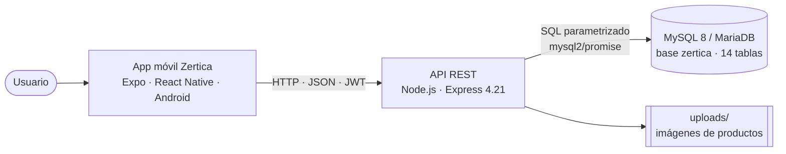
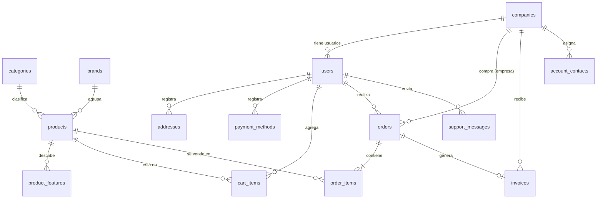
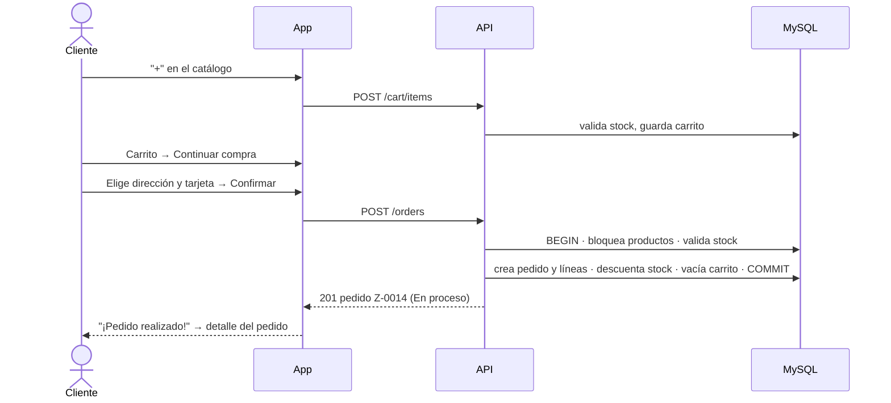

# ZERTICA – Drywall Shop
## Informe técnico y funcional del proyecto

> Documento de referencia para la presentación y el video del proyecto.
> Repositorio: https://github.com/interaxias-cyber/ZERTICA-APP
> Universidad Militar Nueva Granada · Ingeniería de Software · 2026-2

---

## Índice

1. [Resumen ejecutivo](#1-resumen-ejecutivo)
2. [Problema y propuesta de solución](#2-problema-y-propuesta-de-solución)
3. [Alcance del proyecto](#3-alcance-del-proyecto)
4. [Actores y roles](#4-actores-y-roles)
5. [Requerimientos funcionales](#5-requerimientos-funcionales)
6. [Requerimientos no funcionales](#6-requerimientos-no-funcionales)
7. [Casos de uso](#7-casos-de-uso)
8. [Reglas de negocio](#8-reglas-de-negocio)
9. [Arquitectura del sistema](#9-arquitectura-del-sistema)
10. [Tecnologías utilizadas](#10-tecnologías-utilizadas)
11. [Modelo de datos](#11-modelo-de-datos)
12. [API REST](#12-api-rest)
13. [Seguridad](#13-seguridad)
14. [Aplicación móvil: pantallas y navegación](#14-aplicación-móvil-pantallas-y-navegación)
15. [Diseño visual (Figma)](#15-diseño-visual-figma)
16. [Flujos principales](#16-flujos-principales)
17. [Pruebas y calidad](#17-pruebas-y-calidad)
18. [Instalación y despliegue](#18-instalación-y-despliegue)
19. [Usuarios y datos de prueba](#19-usuarios-y-datos-de-prueba)
20. [Decisiones técnicas](#20-decisiones-técnicas)
21. [Limitaciones y trabajo futuro](#21-limitaciones-y-trabajo-futuro)
22. [Cifras del proyecto](#22-cifras-del-proyecto)
23. [Prompt para la presentación (Claude Design)](#23-prompt-para-la-presentación-claude-design)
24. [Guion del video](#24-guion-del-video)
25. [Glosario](#25-glosario)

---

## 1. Resumen ejecutivo

**Zertica – Drywall Shop** es una aplicación móvil para Android que permite consultar y comprar materiales de construcción en seco (placas de yeso, perfilería, tornillería y masillas). Está conectada a un **backend propio en Node.js + Express** y a una **base de datos MySQL 8**.

La aplicación atiende a tres tipos de usuario:

| Rol | Qué puede hacer |
|---|---|
| **Cliente** (usuario registrado) | Consultar el catálogo, buscar y filtrar, ver el detalle, comprar con carrito, seguir sus pedidos y gestionar su perfil, direcciones y tarjetas. |
| **Empresa** (cuenta corporativa) | Todo lo anterior más crédito empresarial, pedidos masivos con descuento por volumen, facturación y contacto con su equipo de cuenta. |
| **Administrador** | Gestionar productos, categorías, usuarios y pedidos; ver un dashboard de ventas y reportes mensuales exportables a PDF y Excel. |

El proyecto se desarrolló en dos etapas:

- **MVP:** autenticación y consulta del catálogo, con los **27 casos de uso** de la especificación y **5 tablas**.
- **Ampliación v2:** todas las pantallas del diseño de Figma (carrito, pedidos, pagos, portal Empresa, reportes), con **9 tablas nuevas**.

Resultado: **24 pantallas de Figma implementadas**, **46 endpoints REST**, **14 tablas**, **25 pruebas de integración** que pasan contra MySQL y MariaDB, y un **APK instalable**. El backend puede ejecutarse en un PC o **dentro del propio celular** con Termux.

---

## 2. Problema y propuesta de solución

### 2.1 Problema

| Problema | Necesidad |
|---|---|
| Información del catálogo dispersa | Centralizar productos, categorías y marcas |
| Búsqueda compleja de productos | Encontrar productos por referencia o nombre |
| Falta de organización | Organizar el catálogo por categorías y marcas |
| Consulta poco accesible | Consultar desde un dispositivo móvil |
| Solo personas autorizadas deben acceder | Autenticación y control por roles |

### 2.2 Solución

Una aplicación móvil con acceso autenticado que organiza el catálogo por categorías y marcas, permite buscar por referencia o nombre, muestra la ficha técnica de cada producto y, en su versión ampliada, completa el ciclo comercial: carrito → pedido → seguimiento → facturación.

**Flujo central (MVP):**
`Autenticarse → Acceder al catálogo → Buscar / filtrar → Seleccionar producto → Consultar detalle`

**Flujo comercial (v2):**
`Agregar al carrito → Finalizar compra → Pedido → Seguimiento → (Empresa) Factura → Pago`

---

## 3. Alcance del proyecto

### 3.1 MVP (especificación integral)

| Módulo | Contenido | Casos de uso |
|---|---|---|
| A · Acceso y autenticación | Idioma, registro con validación, inicio de sesión, recuperación de contraseña, cierre de sesión con confirmación | CU-01 a CU-05 |
| B · Perfil de usuario | Consultar y editar perfil, cambiar contraseña | CU-06 a CU-08 |
| C · Consulta de catálogo | Catálogo por categorías, búsqueda, filtros, productos por categoría, detalle y características | CU-09 a CU-15 |
| D · Gestión de productos | Listado, alta, edición, desactivar/reactivar, imagen | CU-16 a CU-21 |
| E · Gestión de categorías | Crear, editar, desactivar | CU-22 a CU-24 |
| F · Gestión de usuarios | Consultar, ver detalle, activar/desactivar | CU-25 a CU-27 |

### 3.2 Ampliación v2 (pantallas del diseño de Figma)

| Módulo | Pantallas |
|---|---|
| G · Compras | Carrito, Finalizar compra, Mis pedidos, Detalle de pedido |
| H · Cuenta del cliente | Mis direcciones, Métodos de pago, Ayuda y soporte, Términos y privacidad |
| I · Portal Empresa | Mi Empresa, Pedido masivo, Facturación, Mis contactos, Mi cuenta, Usuarios de la cuenta |
| J · Administración comercial | Dashboard de ventas, Pedidos (admin), Reportes |

### 3.3 Fuera de alcance

- Pasarela de pago real: los pagos son **simulados**.
- Notificaciones push, SMS, verificación en dos pasos, biometría, OAuth.
- Inventario avanzado, proveedores, contabilidad, IA y recomendaciones.
- Publicación en Google Play: el APK se instala directamente.

---

## 4. Actores y roles

| Actor | Descripción | Acceso |
|---|---|---|
| **Visitante** | Persona sin sesión iniciada | Registro, inicio de sesión, recuperación de contraseña, selección de idioma |
| **Usuario registrado (Cliente)** | Usuario autenticado con rol `user` | Catálogo, carrito, pedidos, perfil, direcciones, tarjetas, ayuda |
| **Empresa** | Cuenta corporativa con rol `company` asociada a una empresa | Todo lo del cliente + crédito, pedido masivo, facturación, contactos |
| **Administrador** | Personal autorizado con rol `admin` | Panel completo: productos, categorías, usuarios, pedidos, dashboard y reportes |

**Generalización:** `Administrador → Usuario registrado → Visitante`. El rol es un atributo de la tabla `users` (`user | admin | company`).

---

## 5. Requerimientos funcionales

### 5.1 MVP

| Código | Requerimiento | CU |
|---|---|---|
| RF01 | Registrar una cuenta con nombre completo, usuario, correo y contraseña | CU-01 |
| RF02 | Validar los datos de registro: campos obligatorios, formato y unicidad de usuario y correo | CU-02 |
| RF03 | Iniciar sesión con usuario **o** correo y contraseña; rechazar credenciales incorrectas y cuentas desactivadas | CU-03 |
| RF04 | Solicitar la recuperación de la contraseña y restablecerla con un código | CU-04 |
| RF05 | Cerrar la sesión previa confirmación | CU-05 |
| RF06 | Consultar los datos del perfil | CU-06 |
| RF07 | Editar nombre, correo y teléfono del perfil | CU-07 |
| RF08 | Cambiar la contraseña verificando la actual | CU-08 |
| RF09 | Seleccionar el idioma (español o inglés) y guardarlo en la cuenta | — |
| RF10 | Restringir el catálogo a usuarios autenticados y activos | CU-03, CU-09 |
| RF11 | Consultar el catálogo paginado de productos activos de categorías activas | CU-09 |
| RF12 | Obtener las categorías activas | CU-12 |
| RF13 | Buscar productos por referencia o nombre e informar si no hay resultados | CU-10 |
| RF14 | Filtrar productos por categoría o marca | CU-11 |
| RF15 | Consultar los productos de una categoría | CU-13 |
| RF16 | Ver el detalle del producto con sus características | CU-14, CU-15 |
| RF17 | Listar todos los productos, incluidos los desactivados (admin) | CU-16 |
| RF18 | Agregar un producto con imagen obligatoria | CU-17 |
| RF19 | Editar un producto | CU-18 |
| RF20 | Desactivar y reactivar productos sin eliminarlos | CU-19, CU-20 |
| RF21 | Cargar o reemplazar la imagen de un producto | CU-21 |
| RF22 | Crear categorías con nombre único | CU-22 |
| RF23 | Editar categorías | CU-23 |
| RF24 | Desactivar categorías conservando sus productos | CU-24 |
| RF25 | Consultar el listado y el detalle de usuarios | CU-25, CU-26 |
| RF26 | Activar o desactivar cuentas de usuario | CU-27 |

### 5.2 Ampliación v2

| Código | Requerimiento |
|---|---|
| RF27 | Mostrar precio y existencias (stock) de cada producto |
| RF28 | Agregar productos al carrito, cambiar cantidades y quitarlos, validando existencias |
| RF29 | Finalizar la compra eligiendo dirección y método de pago (tarjeta, transferencia o crédito empresarial) |
| RF30 | Registrar el pedido descontando existencias en una transacción |
| RF31 | Consultar el historial de pedidos y su detalle con el estado |
| RF32 | Cancelar un pedido pendiente o en proceso, reponiendo existencias |
| RF33 | Gestionar direcciones de entrega con una dirección principal |
| RF34 | Registrar tarjetas validando número (algoritmo de Luhn) y vencimiento, guardando solo marca y últimos 4 dígitos |
| RF35 | Consultar preguntas frecuentes y enviar mensajes al soporte |
| RF36 | Consultar términos, privacidad, cookies y devoluciones; solicitar la eliminación de la cuenta |
| RF37 | (Empresa) Consultar crédito, cifras del mes, facturas pendientes, puntos y actividad reciente |
| RF38 | (Empresa) Realizar pedidos masivos con descuentos por volumen (5 %, 10 % y 18 %) |
| RF39 | (Empresa) Comprar a crédito con control del límite disponible |
| RF40 | (Empresa) Consultar facturas, generar su PDF y registrar su pago |
| RF41 | (Empresa) Contactar al equipo de cuenta por llamada o WhatsApp |
| RF42 | (Admin) Ver el dashboard: ventas del día, pedidos activos, ventas de la semana, últimos pedidos, productos más vendidos |
| RF43 | (Admin) Gestionar pedidos y cambiar su estado solo mediante transiciones válidas |
| RF44 | (Admin) Generar reportes mensuales de ventas y exportarlos a PDF y Excel (CSV) |
| RF45 | Configurar desde la app la dirección del servidor (backend) y probar la conexión |

---

## 6. Requerimientos no funcionales

| Código | Categoría | Requerimiento | Cómo se cumple |
|---|---|---|---|
| RNF01 | Seguridad | Contraseñas guardadas solo como hash | bcrypt (10 rondas); el hash nunca se devuelve |
| RNF02 | Seguridad | Control de acceso por rol | JWT + middleware `authenticate` y `authorize(rol)`; rutas protegidas también en la app |
| RNF03 | Integridad | Claves foráneas y restricciones únicas | 14 tablas con FK, UNIQUE y CHECK |
| RNF04 | Conservación | No se eliminan registros, se desactivan | Campo `is_active` en usuarios, productos y categorías |
| RNF05 | Seguridad | Validación de entradas y SQL parametrizado | Validadores por módulo; consultas `?`; comodines LIKE escapados |
| RNF06 | Rendimiento | Paginación e índices | 20 por página (máx. 100); índices por categoría, marca, estado y fecha |
| RNF07 | Mantenibilidad | Errores uniformes | `{ error: { code, message, details } }` con códigos estables |
| RNF08 | Internacionalización | Español e inglés | 600+ textos traducidos; los errores se traducen por código |
| RNF09 | Compatibilidad | Android | APK para Android 7.0+ (API 24), arm64 |
| RNF10 | Mantenibilidad | Arquitectura por capas | Rutas → controladores → validadores → servicios → modelos |
| RNF11 | Disponibilidad | Diagnóstico | `GET /api/health` (200 / 503); el servidor no arranca sin base de datos |
| RNF12 | Usabilidad | Interfaz clara | Diseño fiel a Figma; estados de carga, vacío y error con "Reintentar" |
| RNF13 | Consistencia | Operaciones de compra atómicas | Transacciones con bloqueo de filas (`SELECT … FOR UPDATE`) |
| RNF14 | Privacidad | Datos de pago mínimos | Nunca se guarda el número completo ni el CVV |
| RNF15 | Portabilidad | Ejecución sin PC | Backend en el celular con Termux + MariaDB |
| RNF16 | Conectividad | Conexiones lentas | Tiempo de espera de 20 s, reintentos automáticos y caché (React Query) |

---

## 7. Casos de uso

| ID | Caso de uso | Actor | Relación UML |
|---|---|---|---|
| CU-01 | Registrarse | Visitante | include CU-02 |
| CU-02 | Validar datos de registro | — | incluido |
| CU-03 | Iniciar sesión | Visitante | |
| CU-04 | Recuperar contraseña | Visitante | extend CU-03 |
| CU-05 | Cerrar sesión | Usuario | |
| CU-06 | Consultar perfil | Usuario | |
| CU-07 | Editar perfil | Usuario | extend CU-06 |
| CU-08 | Cambiar contraseña | Usuario | extend CU-06 |
| CU-09 | Consultar catálogo | Usuario | include CU-12 |
| CU-10 | Buscar productos | Usuario | extend CU-09 |
| CU-11 | Filtrar productos | Usuario | extend CU-09 |
| CU-12 | Consultar categorías | — | incluido |
| CU-13 | Productos por categoría | Usuario | extend CU-12 |
| CU-14 | Ver detalle de producto | Usuario | include CU-15 |
| CU-15 | Consultar características | — | incluido |
| CU-16 | Listado de productos (admin) | Administrador | |
| CU-17 | Agregar producto | Administrador | include CU-21 |
| CU-18 | Editar producto | Administrador | |
| CU-19 | Desactivar producto | Administrador | extend CU-16 |
| CU-20 | Reactivar producto | Administrador | extend CU-16 |
| CU-21 | Gestionar imagen | Administrador | extend CU-18 |
| CU-22 | Crear categoría | Administrador | |
| CU-23 | Editar categoría | Administrador | |
| CU-24 | Desactivar categoría | Administrador | extend CU-23 |
| CU-25 | Consultar usuarios | Administrador | |
| CU-26 | Ver detalle de usuario | Administrador | extend CU-25 |
| CU-27 | Activar / desactivar usuario | Administrador | |

**Casos de uso de la ampliación v2:** CU-28 Gestionar carrito · CU-29 Finalizar compra · CU-30 Consultar mis pedidos · CU-31 Cancelar pedido · CU-32 Gestionar direcciones · CU-33 Gestionar métodos de pago · CU-34 Solicitar soporte · CU-35 Pedido masivo (Empresa) · CU-36 Pagar factura (Empresa) · CU-37 Contactar equipo de cuenta (Empresa) · CU-38 Gestionar pedidos (Admin) · CU-39 Generar reportes (Admin).

---

## 8. Reglas de negocio

| Código | Regla |
|---|---|
| RN01 | Solo usuarios autenticados y activos acceden al catálogo |
| RN02 | Usuario y correo son únicos |
| RN03 | La contraseña se guarda solo como hash bcrypt |
| RN04 | Una cuenta por persona; el rol es un atributo (`user`, `admin`, `company`) |
| RN05 | Una cuenta desactivada no puede iniciar sesión (y sus sesiones dejan de valer al instante) |
| RN06 | Solo el administrador gestiona productos, categorías, usuarios y pedidos |
| RN07 | Productos, categorías y usuarios se desactivan, no se eliminan |
| RN08 | El catálogo muestra solo productos activos de categorías activas |
| RN09 | Todo producto pertenece a una categoría y una marca existentes |
| RN10 | La referencia del producto es única |
| RN11 | La imagen es obligatoria al crear un producto |
| RN12 | Al desactivar una categoría sus productos se conservan pero se ocultan |
| RN13 | Una característica no se repite dentro de un producto |
| RN14 | Paginación: 20 por defecto, máximo 100; búsqueda de máximo 100 caracteres |
| RN15 | La búsqueda compara referencia o nombre; los comodines `%` y `_` se tratan como texto |
| RN16 | Idioma: español o inglés (por defecto español) |
| RN17 | Cerrar sesión exige confirmación |
| RN18 | Contraseñas: mínimo 8 caracteres, una mayúscula, un número y un carácter especial |
| RN19 | No se puede pedir más unidades que las existencias disponibles |
| RN20 | Un pedido solo se cancela si está Pendiente o En proceso; al cancelar se reponen existencias |
| RN21 | Estados del pedido: Pendiente → En proceso → Enviado → Completado (o Cancelado) |
| RN22 | Descuento por volumen solo para Empresa: +50 u. 5 %, +100 u. 10 %, +500 u. 18 % |
| RN23 | Las compras de Empresa a crédito o transferencia generan una factura a 30 días y consumen crédito; no se puede superar el límite |
| RN24 | Pagar una factura libera el crédito usado |
| RN25 | Cada $10 en compras de Empresa suman 1 punto |
| RN26 | Las facturas pendientes con fecha vencida pasan a "Vencida" |
| RN27 | El administrador no puede desactivar su propia cuenta |
| RN28 | Solo se guardan marca y últimos 4 dígitos de la tarjeta |

---

## 9. Arquitectura del sistema

### 9.1 Vista general



Arquitectura **cliente-servidor en tres capas**: la app nunca accede directamente a la base de datos; todo pasa por la API REST.

### 9.2 Backend por capas

```
Petición HTTP
  └─ routes/         (define la URL y el rol requerido)
      └─ middlewares/ (autenticación JWT, rol, carga de imágenes)
          └─ controllers/ (orquesta)
              └─ validators/ (valida entradas)
                  └─ services/ (lógica de negocio, transacciones, DTO)
                      └─ models/ (SQL parametrizado)
                          └─ config/db.js (pool de 10 conexiones)
Errores → middlewares/errorHandler.js → { error: { code, message, details } }
```

### 9.3 Aplicación móvil

```
src/
  app/          Rutas (Expo Router): (auth), (app)/(tabs), admin/(tabs), company/(tabs)
  screens/      Pantallas: auth, catalog, shop, profile, admin, company
  components/   Botones, campos, tarjetas, chips, encabezados, barra inferior…
  api/          Cliente HTTP (token, tiempo de espera, errores) y servicios por módulo
  hooks/        React Query: catálogo, compras, administración
  providers/    Sesión (AuthProvider), caché, avisos (toast)
  i18n/         Español e inglés
  lib/          Almacenamiento seguro, formatos, PDF y CSV, validaciones
  theme.ts      Colores y estilos del diseño de Figma
```

### 9.4 Opciones de despliegue

| Modo | Backend y base de datos | Conexión de la app |
|---|---|---|
| PC en la misma Wi-Fi | Node.js + MySQL 8 en el PC | IP del PC (p. ej. `192.168.40.99`) |
| Celular autónomo | Node.js + MariaDB en Termux | `127.0.0.1` (sin internet) |
| Nube (futuro) | Hosting Node + MySQL gestionado | Dominio HTTPS |

---

## 10. Tecnologías utilizadas

### 10.1 Aplicación móvil

| Tecnología | Versión | Uso |
|---|---|---|
| Expo SDK | 58 | Plataforma de desarrollo y compilación |
| React Native | 0.88 | Interfaz nativa |
| React | 19.3 | Componentes |
| TypeScript | 6.0 | Tipado estático |
| Expo Router | 58 | Navegación por archivos, rutas protegidas por rol |
| TanStack React Query | 5 | Caché, paginación infinita, reintentos |
| expo-secure-store | 58 | Token de sesión en el Keystore de Android |
| expo-image-picker | 58 | Imagen del producto desde la galería |
| expo-print / expo-sharing / expo-file-system | 58 | PDF de facturas y reportes, exportación CSV |
| Hermes | — | Motor JavaScript optimizado |

### 10.2 Backend

| Tecnología | Versión | Uso |
|---|---|---|
| Node.js | 18+ (probado con 22) | Entorno de ejecución |
| Express | 4.21 | API REST |
| mysql2/promise | 3.11 | Conexión a MySQL (pool de 10) |
| bcrypt | 5.1 | Hash de contraseñas |
| jsonwebtoken | 9 | Sesión con JWT (8 h) |
| multer | 2 | Carga de imágenes (JPG/PNG/WEBP, máx. 5 MB) |
| dotenv | 16 | Configuración por variables de entorno |
| nodemailer | 6 | Correo de recuperación (opcional) |
| node:test | integrado | Pruebas de integración |

### 10.3 Base de datos e infraestructura

| Tecnología | Uso |
|---|---|
| MySQL 8 | Base de datos en el PC |
| MariaDB 10.11+ | Base compatible en el celular (Termux) |
| Termux | Terminal Linux en Android para el backend autónomo |
| Gradle 9 + Android SDK 37 + NDK 27 | Compilación del APK |
| Git + GitHub | Control de versiones |
| Figma | Diseño de las 24 pantallas |

---

## 11. Modelo de datos

### 11.1 Tablas

| # | Tabla | Versión | Contenido |
|---|---|---|---|
| 1 | `users` | MVP (+v2) | Cuentas: usuario, nombre, correo, teléfono, hash, rol, idioma, empresa, estado |
| 2 | `categories` | MVP | Categorías con estado |
| 3 | `brands` | MVP | Marcas |
| 4 | `products` | MVP (+v2) | Referencia única, nombre, descripción, imagen, **precio**, **stock**, categoría, marca, estado |
| 5 | `product_features` | MVP | Características clave-valor |
| 6 | `companies` | v2 | Empresas: razón social, RFC/NIT, crédito (límite y usado), nivel, puntos |
| 7 | `addresses` | v2 | Direcciones de entrega (una principal) |
| 8 | `payment_methods` | v2 | Tarjetas: marca, últimos 4, vencimiento, titular |
| 9 | `cart_items` | v2 | Carrito (usuario + producto + cantidad) |
| 10 | `orders` | v2 | Pedidos: código, estado, subtotal, descuento, total, pago, dirección |
| 11 | `order_items` | v2 | Líneas del pedido (copia de precio y nombre) |
| 12 | `invoices` | v2 | Facturas de empresa: código, monto, estado, vencimiento |
| 13 | `account_contacts` | v2 | Equipo de cuenta de cada empresa |
| 14 | `support_messages` | v2 | Mensajes de ayuda y soporte |

### 11.2 Diagrama entidad-relación



### 11.3 Integridad

- **Claves foráneas:** `products → categories/brands` (RESTRICT), `product_features → products` (CASCADE), `orders → users` (RESTRICT), `order_items → orders` (CASCADE), `invoices → orders/companies`.
- **Únicos:** usuario, correo, referencia, nombre de categoría y marca, (producto, característica), código de pedido, código de factura, RFC de empresa.
- **CHECK:** precio ≥ 0, cantidad en el carrito > 0, crédito ≥ 0.
- **Índices:** categoría + estado, marca + estado, rol + estado, usuario + fecha del pedido, estado + fecha del pedido, empresa + estado de la factura, FULLTEXT (nombre, descripción).

---

## 12. API REST

Todas las rutas cuelgan de `/api`. Autenticación con `Authorization: Bearer <token>`.

### 12.1 Acceso y perfil

| Método y ruta | Acceso | Descripción |
|---|---|---|
| `GET /health` | público | Estado de la API y la base (200 / 503) |
| `POST /auth/register` | público | Registro |
| `POST /auth/login` | público | Inicio de sesión (usuario o correo) → token JWT |
| `POST /auth/forgot-password` · `POST /auth/reset-password` | público | Recuperación de contraseña |
| `POST /auth/logout` | sesión | Cierre de sesión |
| `GET /me` · `PATCH /me` · `PUT /me/password` | sesión | Perfil, idioma, teléfono y contraseña |

### 12.2 Catálogo

| Método y ruta | Acceso | Descripción |
|---|---|---|
| `GET /products?page&limit&search&category_id&brand_id` | sesión | **Contrato documentado** → `{ data, meta }` |
| `GET /products/:id` | sesión | Detalle con características |
| `GET /categories` · `GET /brands` | sesión | Categorías activas y marcas |

### 12.3 Compras (v2)

| Método y ruta | Acceso | Descripción |
|---|---|---|
| `GET /cart` · `POST /cart/items` · `PATCH /cart/items/:id` · `DELETE /cart/items/:id` | cliente, empresa | Carrito |
| `POST /orders` | cliente, empresa | Compra desde el carrito |
| `POST /orders/bulk` | empresa | Pedido masivo |
| `GET /orders` · `GET /orders/:id` · `GET /orders/stats` · `POST /orders/:id/cancel` | cliente, empresa | Mis pedidos |
| `/addresses` (CRUD) · `/payment-methods` (GET, POST, DELETE) | sesión | Direcciones y tarjetas |
| `GET/POST /support/messages` | sesión | Ayuda |
| `GET /company` · `/company/invoices` · `POST /company/invoices/:id/pay` · `/company/contacts` · `/company/users` · `/company/orders` | empresa | Portal Empresa |

### 12.4 Administración

| Método y ruta | Descripción |
|---|---|
| `GET /admin/summary` | Dashboard: ventas, pedidos activos, semana, últimos pedidos, top productos |
| `/admin/products` (GET, POST, PUT, PATCH status) | Productos con imagen, precio y stock |
| `/admin/categories` (GET, POST, PUT, PATCH status) | Categorías |
| `/admin/users` (GET, GET :id, PATCH status) | Usuarios |
| `/admin/orders` (GET, GET :id, PATCH :id/status) | Pedidos y transiciones de estado |
| `GET /admin/reports?month=AAAA-MM` · `GET /admin/reports/export.csv` | Reportes y exportación |

### 12.5 Formato de errores

```json
{ "error": { "code": "INSUFFICIENT_STOCK", "message": "No hay existencias suficientes.", "details": [{ "productId": 5, "available": 120 }] } }
```

Códigos principales: `VALIDATION_ERROR`, `INVALID_CREDENTIALS`, `ACCOUNT_DISABLED`, `SESSION_EXPIRED`, `FORBIDDEN`, `NOT_FOUND`, `ALREADY_EXISTS`, `INSUFFICIENT_STOCK`, `CREDIT_LIMIT_EXCEEDED`, `INVALID_STATUS_TRANSITION`, `CARD_EXPIRED`, `INVALID_CARD`, `DATABASE_UNAVAILABLE`.

---

## 13. Seguridad

| Medida | Detalle |
|---|---|
| Contraseñas | bcrypt con 10 rondas; comparación que no revela si el usuario existe |
| Política de contraseñas | 8+ caracteres, mayúscula, número y carácter especial (pantalla Seguridad de Figma) |
| Sesión | JWT firmado (HS256, 8 h); en cada petición se verifica que la cuenta siga activa |
| Almacenamiento del token | `expo-secure-store` (Keystore de Android) |
| Roles | Middleware `authorize('admin' \| 'company' \| 'user')` + rutas protegidas en la app |
| Recuperación | Código de un solo uso firmado con el hash actual (deja de valer al cambiar la contraseña) |
| SQL | Consultas parametrizadas; comodines LIKE escapados |
| Imágenes | Solo JPG/PNG/WEBP, máx. 5 MB, nombre aleatorio |
| Tarjetas | Validación de Luhn y vencimiento; solo se guardan marca y últimos 4 dígitos |
| Transacciones | Compras, cancelaciones y pagos con `BEGIN/COMMIT` y bloqueo de filas |
| Errores | Los errores internos devuelven 500 sin detalles |

---

## 14. Aplicación móvil: pantallas y navegación

### 14.1 Acceso (visitante)

| Pantalla | Función |
|---|---|
| Selección de idioma | Primera pantalla: español o inglés |
| Iniciar sesión | Correo/usuario y contraseña; botones **Entrar como Usuario**, **Admin** y **Empresa**; ⚙️ Servidor |
| Acceso administrativo | Inicio de sesión solo para administradores |
| Portal Empresa | Inicio de sesión solo para cuentas empresariales |
| Registro | Formulario con validación y reglas de contraseña |
| Recuperar / restablecer contraseña | Código de recuperación |
| Servidor | Dirección del backend y prueba de conexión |

### 14.2 Cliente — barra: Inicio · Catálogo · Carrito · Pedidos · Perfil

| Pantalla | Función |
|---|---|
| Inicio | Bienvenida, banner, categorías, productos |
| Catálogo | Chips de categoría, filtro de marca, tarjetas con precio y botón "+" |
| Búsqueda | Por referencia o nombre, con estado sin resultados |
| Categoría | Productos de una categoría |
| Detalle de producto | Foto, referencia, marca, categoría, precio, stock, cantidad, características |
| Mi Carrito | Cantidades, quitar, totales, carrito vacío |
| Finalizar compra | Dirección, pago (tarjeta/transferencia), notas, resumen |
| Mis Pedidos / Detalle | Historial con filtros, línea de estado, cancelar |
| Mi Perfil | Cifras (pedidos, gastado, direcciones) y menú |
| Datos personales · Seguridad · Idioma | Edición de perfil, contraseña e idioma |
| Mis direcciones · Métodos de pago | Gestión de direcciones y tarjetas |
| Ayuda y soporte · Términos y privacidad | FAQ, mensaje al soporte, políticas |

### 14.3 Empresa — barra: Empresa · Masivo · Facturas · Contacto · Cuenta

| Pantalla | Función |
|---|---|
| Mi Empresa | Crédito (límite/usado/disponible), pedidos y monto del mes, facturas pendientes, puntos, actividad |
| Pedido Masivo | Cantidades por producto, descuentos por volumen, total en vivo |
| Facturación | Por pagar / Pagada / Vencida, Ver PDF, Pagar ahora |
| Mis Contactos | Asesor comercial, soporte técnico y facturación: Llamar y WhatsApp |
| Mi Cuenta | Datos fiscales, usuarios, domicilios, tarjetas, historial, seguridad, soporte |

### 14.4 Administrador — barra: Dashboard · Productos · Pedidos · Usuarios · Reportes · Mi cuenta

| Pantalla | Función |
|---|---|
| Dashboard | Ventas hoy (vs. ayer), pedidos activos, usuarios, productos, gráfica semanal, últimos pedidos, top productos |
| Productos | Búsqueda, filtro de estado, precio, stock, editar y activar/desactivar |
| Formulario de producto | Imagen, referencia, nombre, descripción, precio, stock, categoría, marca |
| Categorías | Listado y formulario |
| Pedidos | Filtros por estado, búsqueda, Ver detalle y Actualizar |
| Usuarios | Rol (Usuario, Empresa, Administrador), estado, nº de pedidos; detalle y activar/desactivar |
| Reportes | Mes, resumen, ventas por categoría, Exportar PDF y Excel |
| Mi cuenta | Datos, contraseña, idioma, catálogo, cerrar sesión |

**Total:** 45 rutas en la app.

---

## 15. Diseño visual (Figma)

| Elemento | Valor |
|---|---|
| Azul marino (principal) | `#0F2044` |
| Azul secundario | `#1A3060` |
| Naranja (acento y botones) | `#F5811E` |
| Fondo | `#F0F0F0` |
| Éxito (Activo / Completado) | fondo `#D1FAE5`, texto `#065F46` |
| Advertencia (En proceso / Por pagar) | fondo `#FEF3C7`, texto `#92400E` |
| Peligro (Cancelado / Vencida) | fondo `#FEE2E2`, texto `#B91C1C` |
| Bordes | 14–16 px redondeados |
| Iconos | Emojis de color (como en Figma) |
| Tipografía | Roboto (sistema Android), pesos 400–800 |

Componentes: encabezado azul con logotipo, tarjetas blancas con sombra suave, chips naranjas, pastillas de estado, barra inferior azul con ícono activo naranja, avisos flotantes.

Las **24 pantallas** del archivo de Figma están implementadas. Diferencias deliberadas: no se implementaron la campana de notificaciones, la foto de perfil, la fecha de nacimiento, el género, la verificación en 2 pasos ni las sesiones activas, porque no hay datos ni requisitos para ellas.

---

## 16. Flujos principales

### 16.1 Compra de un cliente



### 16.2 Pedido masivo de una empresa

1. Mi Empresa muestra un crédito disponible de $400.697.
2. En Masivo indica 60 masillas, 30 perfiles canal y 20 perfiles poste (110 u.).
3. La app aplica el **10 % de descuento** (más de 100 u.) y avisa cuántas unidades faltan para el 18 %.
4. Finalizar compra → **Crédito empresarial** → Confirmar.
5. Se crea el pedido, la **factura FAC-2026-xxxx** (vence a 30 días), se descuenta el crédito y se suman puntos.
6. En Facturación: **Ver PDF** o **Pagar ahora**, que libera el crédito.

### 16.3 Gestión de pedidos (administrador)

`Pendiente → En proceso → Enviado → Completado`, o `Cancelado` desde Pendiente o En proceso. El botón **Actualizar** solo ofrece las transiciones válidas; al cancelar se reponen existencias y se anula la factura pendiente.

---

## 17. Pruebas y calidad

### 17.1 Pruebas automáticas del backend (25)

| Grupo | Qué verifica |
|---|---|
| Acceso (MVP) | Login correcto, incorrecto y con correo; cuenta desactivada; registro y duplicados; política de contraseñas; recuperación con código de un solo uso |
| Catálogo | Contrato de `/api/products`, búsqueda (`search=PLC&category_id=1` → 2), comodines, paginación, límites, detalle |
| Administración | Productos con imagen, desactivar/reactivar, categorías, usuarios, autodesactivación bloqueada, resumen |
| Roles | Usuario sin acceso al panel; empresa sin acceso a admin; admin sin carrito |
| Compras (v2) | Direcciones, tarjetas (Luhn, vencimiento, solo 4 dígitos), carrito, compra con stock, cancelación con reposición |
| Empresa | Pedido masivo con 10 %, límite de crédito, facturas, pago, contactos |
| Panel (v2) | Pedidos, transición inválida rechazada, dashboard, reportes, CSV |

Resultado: **25/25 aprobadas con MySQL 8 y con MariaDB 10.11**.

### 17.2 Pruebas de punta a punta

Recorridos automatizados en navegador contra el backend real, sin errores: idioma, inicio de sesión de los tres roles, registro, recuperación, catálogo, búsqueda, detalle, carrito, compra, cancelación, direcciones, tarjetas, ayuda, términos, portal Empresa (pedido masivo y pago de factura), dashboard, actualización de pedido, reportes y descarga del CSV.

### 17.3 Calidad del código

- TypeScript estricto y ESLint sin errores.
- Separación por capas en el backend y por módulos en la app.
- Textos centralizados en español e inglés.

### 17.4 Prueba en dispositivo

APK instalado en un **Samsung Galaxy S26+**, conectado primero al backend en un PC y después al backend dentro del propio celular (Termux).

---

## 18. Instalación y despliegue

### 18.1 Backend en PC (Windows)

1. Instalar Node.js 18+, MySQL 8 y Git.
2. `git clone https://github.com/interaxias-cyber/ZERTICA-APP.git`
3. `cd ZERTICA-APP/zertica-backend && npm install`
4. Crear `.env` con `DB_USER`, `DB_PASSWORD` y `JWT_SECRET`.
5. `npm run db:init` (crea la base y los datos de prueba).
6. `npm run dev` → `http://0.0.0.0:3000/api`
7. Abrir el puerto 3000 en el firewall y conectar la app con la IP del PC.

### 18.2 Backend en el celular (Termux)

1. Instalar Termux desde F-Droid.
2. Ejecutar:
   `curl -fsSLo setup.sh https://raw.githubusercontent.com/interaxias-cyber/ZERTICA-APP/main/zertica-backend/scripts/termux-setup.sh && bash setup.sh`
3. Reabrir Termux y escribir `zertica`.
4. En la app: ⚙️ Servidor → `127.0.0.1`.

### 18.3 APK

- Compilación local: `npx expo prebuild --platform android` y `./gradlew assembleRelease`.
- Resultado: `Zertica-1.0.0.apk` (35 MB), Android 7.0+, arm64, firmado con clave de depuración.

---

## 19. Usuarios y datos de prueba

| Perfil | Usuario | Correo | Contraseña |
|---|---|---|---|
| Administrador | `admin` | admin@zertica.com | `Admin2026#` |
| Cliente | `juan` | juan@mail.com | `Usuario2026#` |
| Cliente | `maria` | maria@mail.com | `Usuario2026#` |
| Cliente desactivado | `pedro` | pedro@mail.com | `Inactivo2026#` |
| Empresa (premium) | `constructora` | xyz@empresa.com | `Empresa2026#` |
| Empresa | `buildpro` | build@pro.com | `Empresa2026#` |

**Catálogo:** 4 categorías (Placas y paneles, Perfilería, Tornillería, Masillas), 3 marcas (Alfa, Beta, Gamma) y 6 productos con foto, precio y stock. Incluye el ejemplo de la especificación `PLC-STD-12 · Placa de yeso estándar 1/2" · Marca Alfa`.

**Comercio:** 2 empresas (Constructora XYZ con crédito de $500.000; BuildPro MX), 13 pedidos con fechas relativas, 6 facturas (pagadas, pendientes y una vencida), direcciones, tarjetas y equipo de cuenta.

---

## 20. Decisiones técnicas

| Tema | Decisión | Motivo |
|---|---|---|
| Tecnología móvil | Expo (React Native) en lugar de Flutter | Decisión del equipo; misma arquitectura y requisitos |
| Inicio de sesión | Usuario **o** correo | Figma pide correo; los casos de uso, usuario |
| Sesión | JWT sin tabla de sesiones | Simplicidad; la cuenta se revalida en cada petición |
| Rutas de la API | Prefijo `/api` en inglés | Unificar con el código existente |
| Imágenes | Archivos en el servidor, servidos por `/uploads` | Sin servicios externos |
| Recuperación de contraseña | Correo opcional (SMTP); en desarrollo el código se muestra | No hay servicio de correo definido |
| Pagos | Simulados | Fuera del alcance académico; listo para integrar una pasarela |
| Eliminar cuenta | Solicitud al soporte | Regla de no eliminar registros |
| Base en el celular | MariaDB | MySQL no está disponible en Termux; MariaDB es compatible |
| Dirección del servidor | Configurable en la app | Un mismo APK sirve en cualquier red |

---

## 21. Limitaciones y trabajo futuro

**Limitaciones actuales:**
- Pagos simulados (sin pasarela real).
- APK firmado con clave de depuración (no apto para Google Play).
- Backend local: PC en la misma Wi-Fi o Termux en el celular.
- Sin notificaciones push ni correo real por defecto.

**Trabajo futuro:**
1. Desplegar el backend en la nube con HTTPS.
2. Integrar una pasarela de pago (Wompi, Mercado Pago, Stripe).
3. Notificaciones push del estado del pedido.
4. Publicación en Google Play con clave propia.
5. Gestión de marcas y características desde el panel.
6. Inventario con alertas de stock bajo.
7. Pruebas en más dispositivos y versión para iOS.

---

## 22. Cifras del proyecto

| Indicador | Valor |
|---|---|
| Pantallas de Figma implementadas | 24 de 24 |
| Rutas de la aplicación | 45 |
| Archivos TypeScript de la app | 143 (≈ 9.900 líneas) |
| Archivos JavaScript del backend | 46 (≈ 2.900 líneas de código de la API) |
| Endpoints REST | 46 |
| Tablas de la base de datos | 14 (5 MVP + 9 v2) |
| Requerimientos funcionales | 45 |
| Requerimientos no funcionales | 16 |
| Casos de uso | 27 (MVP) + 12 (v2) |
| Reglas de negocio | 28 |
| Pruebas de integración | 25 (100 % aprobadas) |
| Textos traducidos (es/en) | 600+ |
| Tamaño del APK | 35 MB |
| Android mínimo | 7.0 (API 24) |

---

## 23. Prompt para la presentación (Claude Design)

Copia y pega este texto en Claude Design. Adjunta, si puedes, capturas de pantalla de la app y el logotipo de Zertica.

```text
Crea una presentación profesional de 14 diapositivas, en español, para exponer el proyecto académico "ZERTICA – Drywall Shop" (Universidad Militar Nueva Granada, Ingeniería de Software, 2026-2). Formato 16:9.

ESTILO VISUAL
- Paleta: azul marino #0F2044 (fondos y títulos), azul #1A3060 (secundario), naranja #F5811E (acentos, cifras y botones), blanco y gris claro #F0F0F0.
- Estilo moderno y minimalista, tarjetas blancas con bordes redondeados (16 px) y sombras suaves, iconos simples, mucho espacio en blanco.
- Tipografía sans serif geométrica (Inter o similar), títulos en negrita.
- Incluye maquetas de celular (mockups) donde se indique, con las capturas que adjunto.
- El logotipo dice "Zertica" en blanco con un acento naranja y debajo "Drywall Shop".

CONTENIDO

1. Portada: "ZERTICA – Drywall Shop". Subtítulo: "Aplicación móvil para la consulta, compra y gestión de materiales de construcción en seco". Etiquetas: Android · Expo/React Native · Node.js · MySQL. Fondo azul marino, mockup del celular con la pantalla de inicio de sesión.

2. El problema: cuatro tarjetas — información dispersa, búsqueda compleja, falta de organización, consulta poco accesible — y "solo personas autorizadas deben acceder".

3. La solución: flujo en 5 pasos con iconos: Autenticarse → Catálogo → Buscar/filtrar → Detalle → Comprar y seguir el pedido.

4. Usuarios del sistema: tres columnas — Cliente (catálogo, carrito, pedidos, perfil), Empresa (crédito, pedido masivo con descuentos, facturación, contactos), Administrador (productos, categorías, usuarios, pedidos, dashboard, reportes).

5. Alcance: dos bloques — "MVP: 27 casos de uso, 6 módulos, 5 tablas" y "Ampliación v2: carrito, pedidos, pagos, portal Empresa, reportes, 9 tablas nuevas". Nota: "24 de 24 pantallas de Figma implementadas".

6. Requerimientos funcionales: resumen visual por módulos (Acceso, Perfil, Catálogo, Gestión de productos, Categorías, Usuarios, Compras, Empresa, Reportes) con la cifra "45 requerimientos funcionales".

7. Requerimientos no funcionales: iconos para Seguridad (bcrypt, JWT, roles), Rendimiento (paginación, índices), Integridad (transacciones, claves foráneas), Usabilidad (diseño Figma, español/inglés), Compatibilidad (Android 7+), Portabilidad (backend en el celular).

8. Arquitectura: diagrama de tres capas — App móvil (Expo · React Native) → API REST (Node.js · Express, JWT) → Base de datos (MySQL 8 / MariaDB). Debajo, las capas del backend: Rutas → Controladores → Validadores → Servicios → Modelos.

9. Tecnologías: logos o etiquetas agrupadas — App: Expo SDK 58, React Native 0.88, TypeScript, Expo Router, React Query. Backend: Node.js, Express 4.21, mysql2, bcrypt, JWT, multer. Datos: MySQL 8, MariaDB. Herramientas: Figma, Git/GitHub, Gradle/Android SDK, Termux.

10. Modelo de datos: diagrama entidad-relación simplificado con las 14 tablas (users, categories, brands, products, product_features, companies, addresses, payment_methods, cart_items, orders, order_items, invoices, account_contacts, support_messages) y sus relaciones principales.

11. La app en acción (cliente): 3 mockups — Catálogo con precios, Carrito, Detalle del pedido.

12. Portal Empresa y Administración: 4 mockups — Mi Empresa (crédito), Pedido masivo con descuentos 5/10/18 %, Dashboard de ventas, Reportes.

13. Calidad y pruebas: cifras grandes en naranja — "25/25 pruebas de integración", "46 endpoints REST", "14 tablas", "600+ textos en español e inglés", "APK de 35 MB". Mención: "Probado en Samsung Galaxy S26+ con el backend en el propio celular".

14. Conclusiones y trabajo futuro: logros (MVP completo + ampliación, diseño fiel a Figma, funciona sin PC) y próximos pasos (nube con HTTPS, pasarela de pago real, notificaciones push, Google Play). Cierre: "Gracias" y el enlace github.com/interaxias-cyber/ZERTICA-APP.

Usa textos breves en las diapositivas (máximo 6 líneas), destaca las cifras en naranja y añade notas del orador con 2 o 3 frases por diapositiva.
```

---

## 24. Guion del video

**Duración sugerida:** 4–5 minutos · **Formato:** grabación de pantalla del celular + voz en off (+ diapositivas de apoyo).

**Antes de grabar:**
- En Termux ejecuta `zertica-reset` para tener los datos de prueba limpios.
- Arranca el backend con `zertica`.
- Activa el modo "No molestar".
- Usa la grabación de pantalla de Samsung (panel rápido → Grabar pantalla).

| # | Tiempo | Imagen | Narración (voz en off) |
|---|---|---|---|
| 1 | 0:00–0:20 | Portada (diapositiva 1) y logo | "Zertica – Drywall Shop es una aplicación móvil para consultar, comprar y gestionar materiales de construcción en seco, desarrollada para Android con un backend propio y base de datos MySQL." |
| 2 | 0:20–0:40 | Diapositiva del problema y la solución | "Las empresas de drywall tienen su catálogo disperso y es difícil encontrar productos por referencia. Zertica centraliza el catálogo, lo organiza por categorías y marcas, y permite comprar desde el celular." |
| 3 | 0:40–1:00 | Diagrama de arquitectura | "La app está hecha con Expo y React Native, se comunica por API REST con un backend en Node.js y Express, y guarda los datos en MySQL. La sesión usa JWT y las contraseñas se cifran con bcrypt." |
| 4 | 1:00–1:20 | Termux: escribir `zertica` | "El backend puede correr en un computador o, como aquí, dentro del propio celular con Termux, sin necesidad de internet." |
| 5 | 1:20–1:35 | App: selección de idioma → inicio de sesión | "Al abrir la app elegimos el idioma, español o inglés, e iniciamos sesión. Hay tres tipos de acceso: usuario, administrador y empresa." |
| 6 | 1:35–2:15 | Entrar como `juan` → Inicio → Catálogo → buscar "PLC" → filtrar → detalle | "Como cliente, vemos el catálogo con fotos, precios y existencias. Podemos buscar por referencia, por ejemplo PLC, filtrar por categoría o marca y abrir la ficha técnica con sus características." |
| 7 | 2:15–2:50 | "+" en dos productos → Carrito → Finalizar compra → Confirmar → Detalle del pedido | "Agregamos productos al carrito, ajustamos cantidades y finalizamos la compra eligiendo la dirección y la tarjeta. El pedido se registra, se descuentan las existencias y podemos seguir su estado." |
| 8 | 2:50–3:05 | Perfil → Mis direcciones → Métodos de pago → Ayuda | "Desde el perfil gestionamos datos personales, direcciones, tarjetas —de las que solo se guardan los últimos cuatro dígitos—, la contraseña y el soporte." |
| 9 | 3:05–3:40 | Cerrar sesión → Empresa (`constructora`) → Mi Empresa → Masivo (110 u.) → crédito → Facturación → Pagar ahora | "Las cuentas empresariales tienen crédito y pedidos masivos con descuentos por volumen: con más de 100 unidades se aplica el 10 %. Cada compra genera una factura que se puede ver en PDF y pagar." |
| 10 | 3:40–4:20 | Admin (`admin`) → Dashboard → Pedidos → Actualizar → Productos → Reportes → Exportar | "El administrador ve las ventas del día y de la semana, actualiza el estado de los pedidos, gestiona productos, categorías y usuarios, y genera reportes mensuales exportables a PDF y Excel." |
| 11 | 4:20–4:40 | Diapositiva de calidad y pruebas | "El proyecto implementa las 24 pantallas del diseño, 46 servicios REST y 14 tablas, y supera 25 pruebas de integración automatizadas." |
| 12 | 4:40–5:00 | Diapositiva de cierre | "Como trabajo futuro planteamos el despliegue en la nube, una pasarela de pago real y la publicación en Google Play. Gracias." |

**Consejos de grabación:**
- Graba cada escena por separado y únelas en un editor (CapCut, Clipchamp o FlexClip).
- Usa movimientos lentos: deja 1 segundo quieto en cada pantalla antes de tocar.
- Graba la voz aparte, en un lugar sin eco, y ajústala al video.
- Exporta en 1080p vertical para redes o en 16:9, con el celular centrado sobre un fondo azul marino, para la exposición.

---

## 25. Glosario

| Término | Significado |
|---|---|
| API REST | Interfaz que expone servicios por HTTP con JSON |
| APK | Archivo instalable de una app Android |
| bcrypt | Algoritmo de cifrado unidireccional para contraseñas |
| CRUD | Crear, leer, actualizar y eliminar |
| Drywall | Construcción en seco con placas de yeso y perfiles metálicos |
| Endpoint | Ruta concreta de la API (p. ej. `GET /api/products`) |
| Expo | Plataforma para crear apps con React Native |
| JWT | Token firmado que identifica la sesión del usuario |
| MariaDB | Base de datos compatible con MySQL |
| MVP | Producto mínimo viable: primera versión funcional |
| Hash | Resultado de cifrar un dato de forma irreversible |
| Luhn | Algoritmo para validar números de tarjeta |
| React Native | Framework para crear apps móviles nativas con JavaScript |
| Termux | Terminal Linux para Android |
| Transacción | Grupo de operaciones que se aplican todas o ninguna |
